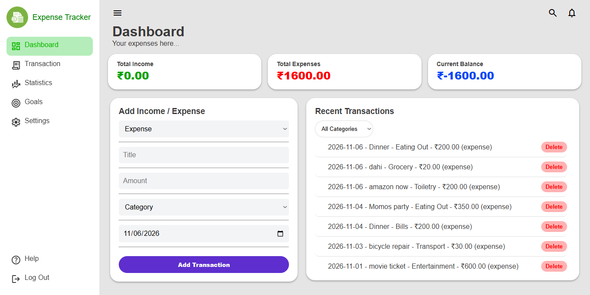

# Expense Tracker

A responsive personal expense tracker built using HTML, CSS and Vanilla JavaScript. Track income and expenses, manage transactions, and monitor your overall financial balance through a clean dashboard.

## 🚀 Live Demo

[View Live Project](expense-tracker-theta-five-26me8nlh6t.vercel.app/)

## 📸 Preview



## ✨ Features

- **Dashboard Overview** – View total income, expenses and available balance.
- **Transaction Management** – Add, edit and delete transactions.
- **Category Filtering** – Filter transactions by category.
- **Search Functionality** – Search transactions by description.
- **Date-Based Sorting** – Display the newest transactions first.
- **Data Persistence** – Save transactions using LocalStorage.
- **Delete Confirmation** – Prevent accidental transaction deletion.
- **Responsive Design** – Mobile-friendly layout with an interactive sidebar.
- **Empty State** – Helpful message when no transactions are available.

## 🛠️ Tech Stack

- HTML5
- CSS3
- JavaScript (Vanilla JS)
- Browser LocalStorage
- Git & GitHub
- Vercel

## 💻 Run Locally

1. Clone the repository:

   ```bash
   git clone https://github.com/dhanverma/expense-tracker
   ```

2. Open the project folder.

3. Open `index.html` in your browser.

No additional dependencies or installations are required.

## 📚 What I Learned

- DOM manipulation and event handling.
- JavaScript array methods (`map`, `filter`, `reduce`, `sort`).
- Managing application state with JavaScript.
- Working with LocalStorage.
- Implementing search and filtering functionality.
- Building responsive layouts.
- Git version control and deployment using Vercel.

## 👨‍💻 Author

**Dhanraj Verma**

- GitHub: [@dhanverma](https://github.com/dhanverma)

---

⭐ If you like this project, consider giving it a star!